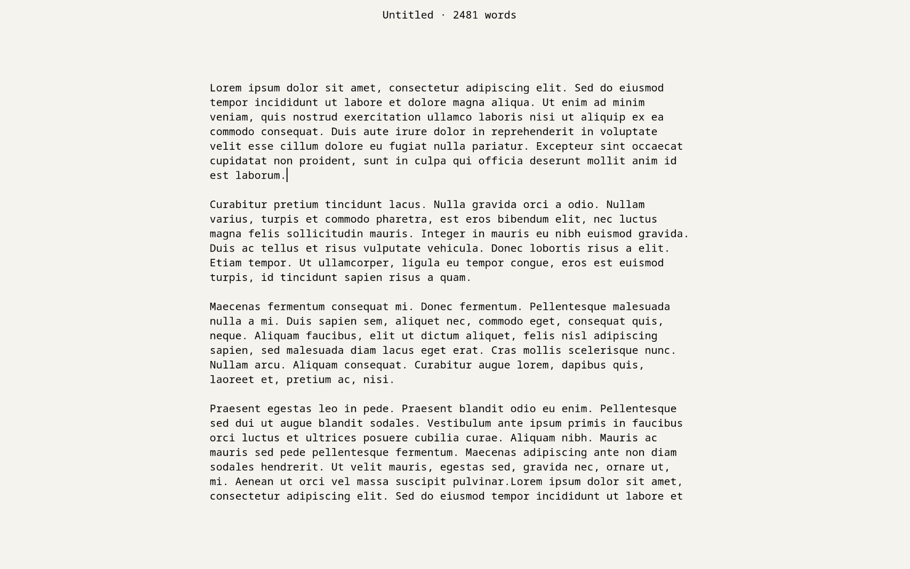

# Nanowrite

A modified GNU nano 9.2 build for prose writing, designed for Fedora Sway Atomic
and the foot terminal.



Nanowrite stays separate from system nano, with its own executable and
configuration. In this setup, it's opened only through the **Nanowrite** entry
in rofi for writing fiction and non-fiction. The normal `nano` command continues
to open system nano with its usual configuration.

> **Warning:** Open only locally made or known-safe text files in Nanowrite.
> It won't be updated as frequently as system nano and may miss security fixes.

## Features

- Black text on an off-white background.
- Centered writing column, up to 76 terminal columns wide, with ragged-right soft wrapping.
- Centered filename and live word count, separated by a small dot.
- Minimal interface, a thin non-blinking cursor, and click-to-position mouse support.
- Top and bottom spacing to separate the document from the header and save prompts.

Wrapping and margins affect only the display; they don't insert spaces or line
breaks into the document. The word count includes unsaved changes.

## Installation

The bundled executable requires x86_64 Linux, Bash, foot, glibc 2.38 or later,
and ncursesw/tinfo ABI 6. No sudo or compiler is needed.

Extract `nanowrite.zip`, enter the extracted `nanowrite` directory, and run:

```bash
bash install.sh
```

The installer places the editor in
`${XDG_DATA_HOME:-$HOME/.local/share}/nanowrite/` and the launcher at
`~/.config/rofi/scripts/nanowrite.sh`.

Use **Nanowrite** as the label in your rofi menu and configure that entry to run:

```bash
bash "$HOME/.config/rofi/scripts/nanowrite.sh"
```

An example `rofi-apps` menu is included in the package.

## Usage

- **Ctrl+O:** save.
- **Ctrl+X:** exit.
- **Left-click:** position the cursor.
- **Shift-drag:** select text through the terminal.

Colours, column width, and top spacing can be adjusted near the top of the
installed launcher.

## Source and maintenance

The package includes the complete modified source and patch in `source/`.
Nanowrite is a separate executable: Fedora's nano updates won't update it.
Rebuilding is needed to incorporate upstream fixes or address future
compatibility problems.

Based on GNU nano; distributed under the GNU GPL, version 3 or later. See
`COPYING` in the package. This is an unofficial modification of GNU nano.
