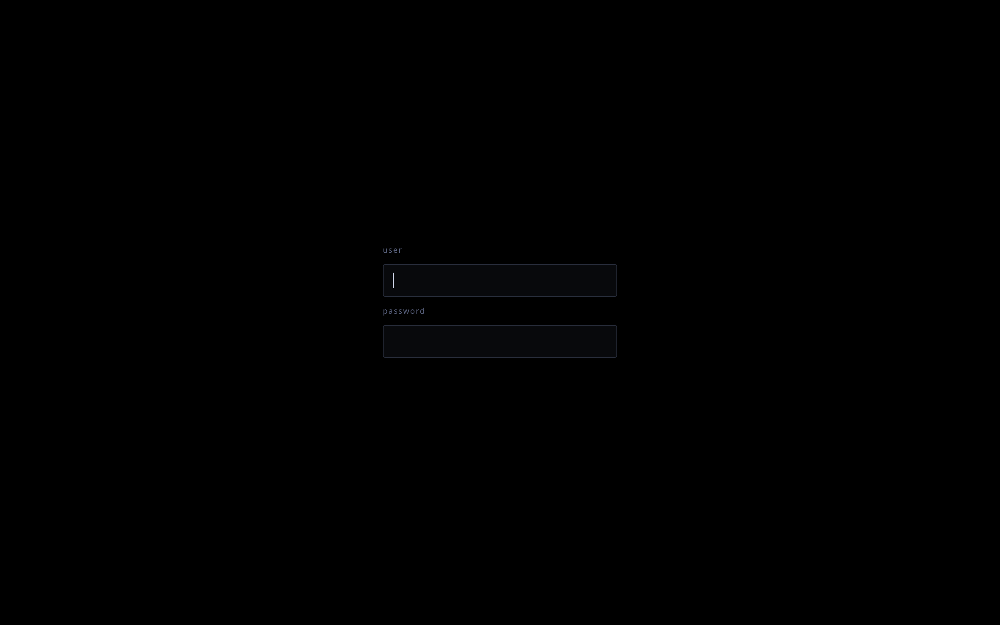

# SDDM Rice

A minimal black and `#8a97bf` login screen for **Fedora Sway Atomic**, with a transparent mouse pointer during the greeter and the transition into your desktop.



Requires Fedora's standard **Wayland/Sway SDDM setup with the Qt 6 greeter** and administrator access through `sudo`. No additional packages are needed.

## Install

Download [sddm-rice.zip](sddm-rice.zip), extract it into a fresh folder, and open a terminal inside the extracted `sddm-rice` directory. Run:

```bash
sudo python3 setup.py
```

Reboot when ready. The installer doesn't restart SDDM or end your current session.

To check compatibility without changing anything:

```bash
sudo python3 setup.py --check
```

Running the installer again updates this rice's files. Previous versions aren't saved.

## Why this version is simpler

Version **1.12** keeps the same login-screen design while simplifying installation and removal:

- **One script** installs, checks and removes the rice.
- **One custom folder and one override** hold the installation. New installations leave Fedora's greeter configuration unchanged.
- **No backup or restore machinery** means no backup imports, installation history or administrator-run restoration of old backup files.
- **Removal deletes our files**, allowing the remaining SDDM settings to take effect.

The custom files are owned by root. SDDM can read them but can't change them. The installer also checks for conflicting settings and unsafe file ownership, permissions or links before installation.

There are no extra background processes. Because there are no backups, removal doesn't recover an earlier custom setup.

## How it works

The installation uses these two locations:

```text
/etc/sddm-rice/
/etc/sddm.conf.d/99-sddm-rice.conf
```

The folder contains the theme, transparent cursor assets and a small greeter configuration. The override tells SDDM to use them.

The custom greeter configuration includes Fedora's existing `/etc/sway/sddm-greeter.config`, then selects the transparent cursor. Fedora's compositor launcher and hardware handling are retained. Nothing under `/usr` is modified, and SELinux labels are applied with `restorecon`.

Fedora Sway Atomic permits administrator changes under `/etc`. Your desktop cursor and boot console are controlled separately; the text insertion caret in the login fields remains visible.

Keep separate personal SDDM settings in another configuration file. The custom folder and override belong to this rice and are removed together when uninstalling.

## Upgrade and remove old files

### 1. Install this version

Follow the installation instructions above. Don't run the old `uninstall.py` before or after migration.

The installer recognises and replaces its standard old `99-sddm-rice.conf`. If that file contains additional settings, it stops so you can move them into a separate `.conf` file first.

It also removes the exact cursor-setting block appended by the old installer to `/etc/sway/sddm-greeter.config`. Other greeter settings are retained. This is a one-time cleanup; subsequent installations use the separate custom configuration.

Old backups are never read or imported.

### 2. Reboot and check the login screen

Confirm that the new login screen works and that you can enter your desktop before deleting the old files.

### 3. Delete the old installation files

Once the new version is working, run:

```bash
sudo rm -rf -- \
  /var/lib/sddm/rice-backups \
  /var/lib/sddm/themes/sddm-rice \
  /var/lib/sddm/.icons/sddm-rice-invisible \
  /var/lib/midnight-sway-atomic-sddm
```

**This permanently deletes the old backups.** These locations aren't used by the new version. Remove only the listed legacy locations; keep `/var/lib/sddm` itself and the two new installation paths under `/etc`.

You can also discard the old extracted installer folder. Files generated by the old scripts may require `sudo` to delete. Don't use the old installer or uninstaller again after migration.

## Remove this version

From the newly extracted `sddm-rice` directory, run:

```bash
sudo python3 setup.py uninstall
```

Reboot when ready. This removes `/etc/sddm-rice/` and its SDDM override. The remaining Fedora or personal SDDM settings then take effect; no old backups are restored.

## Controls

| Input | Action |
|---|---|
| `Enter` | Username → password → login |
| `Ctrl+1` through `Ctrl+9` | Same action as `Enter` |
| `Tab` / `Shift+Tab` | Switch fields |
| `Escape` in the password field | Clear the password |

The last valid desktop session remains selected; there is no session chooser. A failed login displays `Authentication failure` and clears the password. Passwords are masked immediately.
