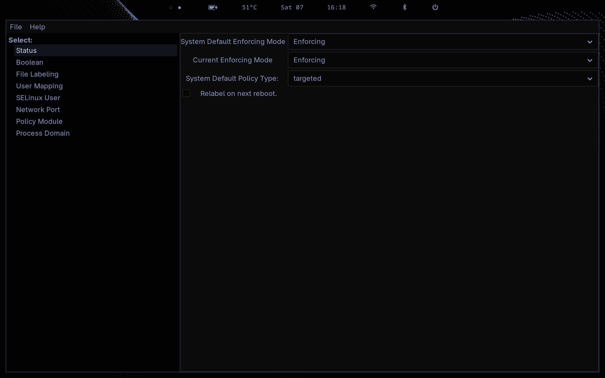

# SELinux Management on Fedora Sway Atomic

Install Fedora's `system-config-selinux` GUI and open it in a Sway Wayland session.

Installation and launch require administrator authorization. Existing account and polkit restrictions still apply.

The Midnight theme uses one CSS file over GTK's built-in Adwaita dark theme. It retains the GUI's layout, sizes and controls.



## Install

Use an account authorized to install system packages.

```bash
# Install the SELinux administration GUI and its dependencies.
run0 rpm-ostree install policycoreutils-gui
```

After installation succeeds:

```bash
# Reboot to activate the deployment containing the installed package.
systemctl reboot
```

## Install the theme

Save the supplied stylesheet as `gtk.css` and open a terminal in the directory containing it.

```bash
# Create the GUI's separate, root-owned GTK configuration directory.
run0 install -d -o root -g root -m 0755 /etc/selinux-gui/gtk-3.0

# Install the stylesheet as a root-owned file.
run0 install -o root -g root -m 0644 gtk.css /etc/selinux-gui/gtk-3.0/gtk.css
```

## Open from a terminal

Run this from an ordinary terminal inside your running Sway session, before switching to an administrator or root shell:

```bash
# Start the GUI as a temporary root service, independent of this terminal.
systemd-run --collect --service-type=exec \
  --setenv=GDK_BACKEND=wayland \
  --setenv=WAYLAND_DISPLAY="$XDG_RUNTIME_DIR/$WAYLAND_DISPLAY" \
  --setenv=GTK_THEME=Adwaita:dark \
  --setenv=XDG_CONFIG_HOME=/etc/selinux-gui \
  /usr/share/system-config-selinux/system-config-selinux.py
```

The packaged launcher uses `pkexec`, which filters the environment and can leave the GUI without a display connection. The command above supplies the Wayland backend and the full path to the display socket directly.

After the GUI opens, you can close the terminal. The temporary service ends when you close the GUI; `--collect` removes its unit afterward.

To adjust the theme later, edit `/etc/selinux-gui/gtk-3.0/gtk.css` with your administrator editor, then close and reopen the GUI. The launch command applies this configuration to the GUI and its child processes.

## Open from Rofi

Add the launch command directly to your existing `rofi-apps` script. Keep `SELinux` in its menu list, then add or replace this branch inside `case "$choice" in`, before the final `*)` fallback:

```bash
  "SELinux")
    systemd-run --quiet --collect --service-type=exec \
      --setenv=GDK_BACKEND=wayland \
      --setenv=WAYLAND_DISPLAY="$XDG_RUNTIME_DIR/$WAYLAND_DISPLAY" \
      --setenv=GTK_THEME=Adwaita:dark \
      --setenv=XDG_CONFIG_HOME=/etc/selinux-gui \
      /usr/share/system-config-selinux/system-config-selinux.py >> "$logfile" 2>&1 &
    ;;
```

This uses the script's existing `$logfile` variable. A graphical polkit authentication agent must be running for administrator password prompts.

## Troubleshooting

Rofi launcher errors go to the existing `rofi-apps.log`. For application errors, use the terminal launch command above, note the service name it prints, and check its logs:

```bash
# Replace UNIT.service with the printed service name.
run0 journalctl -b -u UNIT.service --no-pager
```
